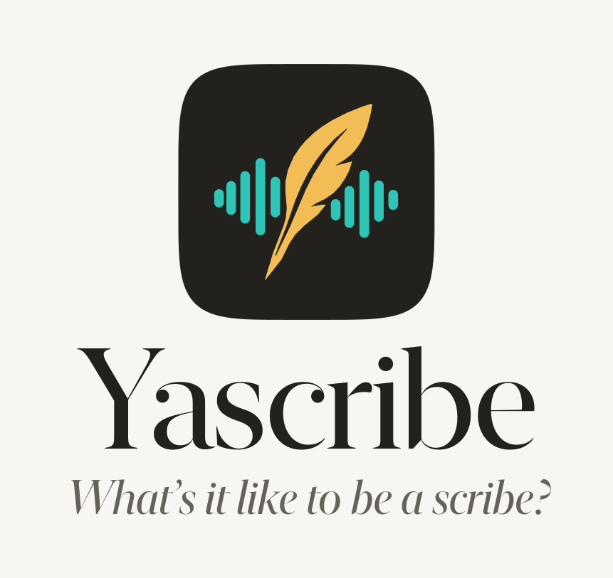
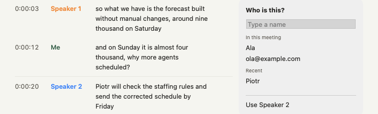
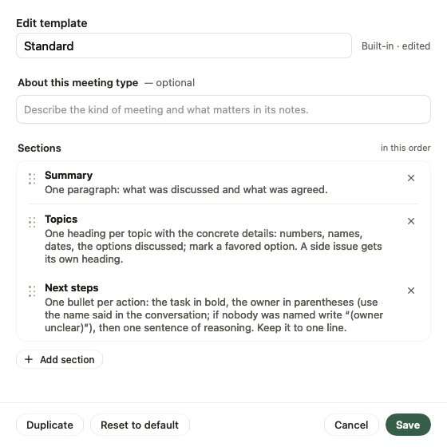

<p align="center">
  <picture>
    <source media="(prefers-color-scheme: dark)" srcset="docs/readme/logo/logo-pionowe-ciemne.svg">
    
  </picture>
</p>

# Yascribe: skryba, który rozumie po polsku

Natywna aplikacja na macOS do notatek ze spotkań. Nagrywa rozmowę na Macu, sporządza transkrypcję po polsku, rozpoznaje rozmówców i przygotowuje notatkę. Możesz też zadawać pytania o jedno spotkanie lub całe archiwum i dyktować tekst w dowolnej aplikacji. **Do rozmowy nie dołącza żaden bot.**

*English: a native macOS meeting-notes app that records system audio and microphone as two separate tracks, transcribes locally or via API, tells speakers apart, writes notes with a model you choose, answers questions about your meetings and does system-wide dictation. The app UI is currently English; Polish UI is planned.*

Sam wybierasz język i decydujesz, czy przetwarzać dane lokalnie, czy przez API. Aplikacja nagrywa dźwięk na dwóch osobnych ścieżkach i jest wolnym oprogramowaniem (GPL-3.0). To jednoosobowy projekt w trakcie rozwoju (wersje alfa 0.1.x). Interfejs jest na razie po angielsku, a dokumentacja w repozytorium jest po polsku. Polski interfejs jest w planach.

<table>
  <tr>
    <td width="50%">
      <picture>
        <source media="(prefers-color-scheme: dark)" srcset="docs/readme/img/meetings-next-dark.png">
        
      </picture>
      <b>Najbliższe spotkanie.</b> Na karcie spotkania z kalendarza Apple wystarczy kliknąć „Record”. Na liście są foldery spotkań, a na dole pole „Ask about All meetings”.
    </td>
    <td width="50%">
      <picture>
        <source media="(prefers-color-scheme: dark)" srcset="docs/readme/img/meeting-summary-dark.png">
        
      </picture>
      <b>Po otwarciu spotkania od razu widzisz notatkę.</b> Z podsumowania dowiesz się, kto odpowiada za każde zadanie i z czego ono wynika. „Copy” kopiuje notatkę, a „Improve…” pozwala wygenerować ją ponownie innym modelem.
    </td>
  </tr>
  <tr>
    <td width="50%">
      <picture>
        <source media="(prefers-color-scheme: dark)" srcset="docs/readme/img/speakers-transcript-dark.png">
        
      </picture>
      <b>Kto mówi?</b> Każdy rozmówca ma numer i kolor. Kliknij jego oznaczenie, by otworzyć listę „Who is this?” z uczestnikami z kalendarza i osobami z poprzednich spotkań.
    </td>
    <td width="50%">
      <picture>
        <source media="(prefers-color-scheme: dark)" srcset="docs/readme/img/speakers-summary-dark.png">
        
      </picture>
      <b>Imiona także w notatce.</b> W notatce widać imiona przypisane rozmówcom. Gdy zmienisz imię, zmiana od razu pojawi się w notatce, kopii i archiwum, bez ponownego generowania notatki.
    </td>
  </tr>
</table>

*Dane na zrzutach są przykładowe.*

## Obsługa języka polskiego

Gotowe narzędzia dobrze radzą sobie z angielskim. Język polski zwykle wymaga trybu wielojęzycznego, w którym model sam rozpoznaje język. Czasem się myli i potrafi zapisać polską rozmowę cyrylicą. W Yascribe **sam wskazujesz modelowi język**, a automatyczne wykrywanie służy tylko jako opcja awaryjna.

- **Wybór języka.** Preset określa język oraz modele do transkrypcji, korekty i tworzenia notatki, dzięki czemu wszystkie etapy korzystają z jednego ustawienia języka. Gdy zaczynasz nagrywać, widzisz oznaczenie „Polish · PL”.
- **Usuwanie polskich przerywników.** Korekta usuwa z transkrypcji „yyy”, „mhm” i podobne przerywniki. Surowy zapis pozostaje bez zmian.
- **Modele obsługujące polski.** Parakeet TDT v3 (483 MB) i Parakeet Ultra (632 MB) działają w całości na Macu, bez dostępu do sieci.
- **Nazwy własne i odmiana.** Do słownika możesz dodać własne terminy i aliasy. Pomaga poprawnie zapisywać nazwy także w odmienionych formach. Aplikacja uwzględnia terminy ze słownika i uczestników z kalendarza w poleceniach do korekty i tworzenia notatki.
- **Sprawdzanie liczb.** Korekta ma zachować sens wypowiedzi. W notatce pojawia się ostrzeżenie, jeśli zawiera ona liczbę, której nie było w transkrypcji.

## Jak to działa

1. **Nagrywasz.** Aplikacja zapisuje dźwięk systemowy i dźwięk z mikrofonu w osobnych plikach, bo po zmiksowaniu obu ścieżek nie da się odzyskać czystego głosu. Każdą ścieżkę możesz wyciszyć jednym kliknięciem. Gdy wyciszysz mikrofon w Teams, aplikacja wyciszy również jego ścieżkę w nagraniu.
2. **Transkrybujesz.** Możesz użyć lokalnego modelu Parakeet lub skorzystać z API (OpenRouter, ElevenLabs Scribe v2, oMLX z modelem Whisper lub Qwen3-ASR albo dowolny endpoint zgodny z OpenAI). Przed transkrypcją aplikacja usuwa echo głośników ze ścieżki mikrofonu, dzięki czemu nie przypisuje głosów innych rozmówców do „Me”. Jeśli transkrypcja się przerwie, aplikacja wznawia ją od miejsca przerwania.
3. **Rozpoznajesz rozmówców.** Scribe v2 sam rozróżnia rozmówców. Na Macu robi to lokalny model, a w chmurze możesz też użyć Mistrala. Imiona przypisujesz rozmówcom jednym kliknięciem.
4. **Poprawiasz.** Model usuwa przerywniki, a słownik poprawia nazwy własne. Aplikacja dzieli transkrypcje długich spotkań na fragmenty, które mieszczą się w oknie kontekstowym modelu. Opcja „Improve…” pozwala powtórzyć korektę innym modelem.
5. **Dostajesz notatkę.** Aplikacja tworzy ją na podstawie szablonu z własnymi sekcjami i kontekstu spotkania. Model możesz wybrać osobno dla każdego spotkania. W „Settings” możesz zmienić polecenia do korekty i tworzenia notatki.
6. **Pytasz.** W „Ask” możesz zadawać pytania o jedno spotkanie, folder lub całe archiwum. Odpowiedzi zawierają odnośniki do źródeł. Historię rozmów znajdziesz w „Past chats”.

Gdy kończy się rozmowa w Teams, w panelu nagrywania pojawia się pytanie „Meeting ended?”. Po 5 sekundach bez odpowiedzi aplikacja kończy nagranie. „Continue” przerywa odliczanie.

**Dyktowanie.** Aby dyktować tekst do dowolnej aplikacji, przytrzymaj lub naciśnij klawisz przypisany do skrótu globalnego (domyślnie Fn). Dyktowanie korzysta z tego samego modelu transkrypcji, słownika i filtra przerywników. Korekta jest opcjonalna, a historia zawiera wyłącznie tekst.

<table>
  <tr>
    <td width="50%">
      <picture>
        <source media="(prefers-color-scheme: dark)" srcset="docs/readme/img/pill-expanded-dark.png">
        
      </picture>
      <b>Panel nagrywania.</b> Panel pokazuje nazwę urządzenia oraz osobno poziom dźwięku systemowego i mikrofonu. Każdą ścieżkę możesz wyciszyć, a mikrofon możesz zmienić w trakcie nagrania.
    </td>
    <td width="50%">
      <picture>
        <source media="(prefers-color-scheme: dark)" srcset="docs/readme/img/pill-offer-call-dark.png">
        
      </picture>
      <b>Nagrywanie rozmów w Teams.</b> Gdy aplikacja wykryje rozmowę, proponuje rozpoczęcie nagrania z wybranym presetem.
    </td>
  </tr>
  <tr>
    <td width="50%">
      <picture>
        <source media="(prefers-color-scheme: dark)" srcset="docs/readme/img/templates-builtin-dark.png">
        
      </picture>
      <b>Szablony notatek.</b> Możesz wybrać szablon Standard, 1:1, cotygodniówkę lub rozmowę z klientem albo utworzyć własny. Opis każdej sekcji określa, co model ma w niej zapisać.
    </td>
    <td width="50%">
      <picture>
        <source media="(prefers-color-scheme: dark)" srcset="docs/readme/img/settings-on-this-mac-dark.png">
        
      </picture>
      <b>Modele lokalne i w chmurze.</b> Do wyboru masz Parakeet na Macu, OpenRouter, ElevenLabs, Mistral, Ollama, llama.cpp, oMLX i dowolny endpoint zgodny z OpenAI. Eksperymentalnie możesz też skorzystać z Codexa i Claude Code po zalogowaniu się na własne konto.
    </td>
  </tr>
</table>

## Twoje dane

- **Bez bota.** Rozmowę nagrywasz na swoim Macu. Pozostali uczestnicy nie widzą na liście żadnej dodatkowej osoby.
- **Wszystko lokalnie.** Aplikacja zapisuje nagrania, transkrypcje i notatki w `~/Library/Application Support/Yascribe`. Możesz transkrybować nagrania za pomocą Parakeeta, rozpoznawać rozmówców na Macu i tworzyć notatki za pomocą Ollamy, llama.cpp lub oMLX bez dostępu do sieci. Aplikacja wysyła do chmury tylko te dane, które wybierzesz. Przy wyborze dostawcy wskazuje, dokąd wyśle transkrypcję.
- **Czas przechowywania nagrań.** Możesz włączyć automatyczne usuwanie nagrań po wybranym czasie, na przykład po 30 dniach. Aplikacja zachowuje transkrypcje i notatki, a nagrania usuwa dopiero po zakończeniu transkrypcji.
- **Klucze API** wpisujesz w aplikacji, która zapisuje je w pęku kluczy macOS. Codex i Claude Code mają osobne logowanie. Yascribe nie przechowuje ich kluczy.

## Agenci AI (MCP)

Yascribe ma serwer MCP na stdio, więc Claude Code, Codex, OpenCode, Hermes i pi mogą czytać Twoje spotkania:
listę z wyszukiwaniem, transkrypt i notatkę, a także całe spotkanie jako markdown. Serwer tylko czyta i nic
nie wychodzi z niego bez Twojej zgody: włącz ją w **Settings → Agent access (MCP)**. Instrukcja podłączenia
dla każdego klienta: [docs/readme/mcp.md](docs/readme/mcp.md).

## Instalacja

1. Pobierz `Yascribe-<wersja>.zip` z [Releases](https://github.com/sharezz1/yascribe/releases/latest), rozpakuj archiwum i przeciągnij `Yascribe.app` do `/Applications`.
2. Aplikacja ma podpis z certyfikatem Apple Development. **Nie ma jeszcze notaryzacji**, więc przy pierwszym uruchomieniu macOS poprosi o zgodę (Ustawienia systemowe → Prywatność i ochrona → „Otwórz mimo to”). Notaryzacja jest w planach.
3. Przy pierwszym nagraniu udziel dostępu do mikrofonu, dźwięku systemowego i opcjonalnie do kalendarza. Synchronizacja wyciszenia z Teams i dyktowanie wymagają też uprawnienia „Accessibility”, a skrót do dyktowania dodatkowo uprawnienia „Input Monitoring”.
4. Aktualizacje sprawdzisz przez Yascribe → „Check for Updates…” lub w menu na pasku. Aplikacja instaluje aktualizację dopiero po kliknięciu i nigdy nie przerywa trwającego nagrania.

Aplikacja wymaga macOS 27.

## Co dalej

**Już działa.** Nagrywanie na dwóch ścieżkach z wyciszaniem, wykrywaniem końca spotkania i zmianą mikrofonu w trakcie nagrania · usuwanie echa głośników ze ścieżki mikrofonu · transkrypcja lokalna (Parakeet v3, Parakeet Ultra) i przez API · rozpoznawanie rozmówców i wyświetlanie ich imion w transkrypcji i notatce · korekta z filtrem przerywników i własnymi poleceniami · słownik z obsługą odmiany, importu i eksportu · notatki z szablonów i wybór modelu dla każdego spotkania · pytania w „Ask” o spotkanie, folder lub archiwum · dyktowanie do dowolnej aplikacji · modele lokalne (Ollama, llama.cpp, oMLX, własny endpoint) i agenci CLI (Codex, Claude Code) · nagrywanie z użyciem słuchawek Bluetooth · kalendarz Apple i proponowanie nagrania po wykryciu rozmowy w Teams · foldery, krótki opis spotkania („Overview”) oraz archiwum z wyszukiwarką i ustawieniem czasu przechowywania nagrań · jasny i ciemny motyw · aktualizacje jednym kliknięciem · narzędzie `yascribe-cli` do transkrypcji, korekty, tworzenia notatek i rozpoznawania rozmówców w terminalu · serwer MCP dla agentów AI (lista spotkań, transkrypt, notatka i eksport do markdown).

**W kolejce**

- polski interfejs (aplikacja już rozumie polski, a jej interfejs jest na razie po angielsku),
- dodawanie aliasu do słownika przez kliknięcie słowa w transkrypcji oraz podpowiadanie słów lokalnemu modelowi (word boosting) po pomiarach,
- transkrypcja na żywo i możliwość wznowienia nagrywania w ramach tej samej notatki,
- kolejne lokalne modele transkrypcji,
- „Record now” w menu na pasku.

**Pomysły bez terminu.** Notaryzacja i Developer ID · Google Calendar, Outlook, Slack.

## Budowanie

Do zbudowania aplikacji wystarczą Command Line Tools (Swift 6.4). Xcode nie jest potrzebny.

```
swift package --disable-keychain resolve
scripts/run.sh          # buduje i uruchamia z danymi w .devdata/
scripts/test.sh         # jedyny sposób uruchamiania testów
scripts/bundle.sh       # składa .build/Yascribe.app
```

## Nazwa i znak

Motto „What's it like to be a scribe?” nawiązuje do monologu skryby z filmu „Asterix i Obelix: Misja Kleopatra”. Pióro symbolizuje zapis, a fale po bokach przedstawiają dwie ścieżki nagrania, jedną dla dźwięku systemowego i drugą dla mikrofonu.

## Licencja

Yascribe jest wolnym oprogramowaniem na licencji **GNU GPL v3** (plik [LICENSE](LICENSE)). Licencje zależności i informacje o ich autorach znajdziesz w pliku [THIRD_PARTY_NOTICES.md](THIRD_PARTY_NOTICES.md).

Copyright (C) 2026 Michał Przytulski