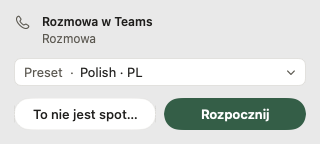
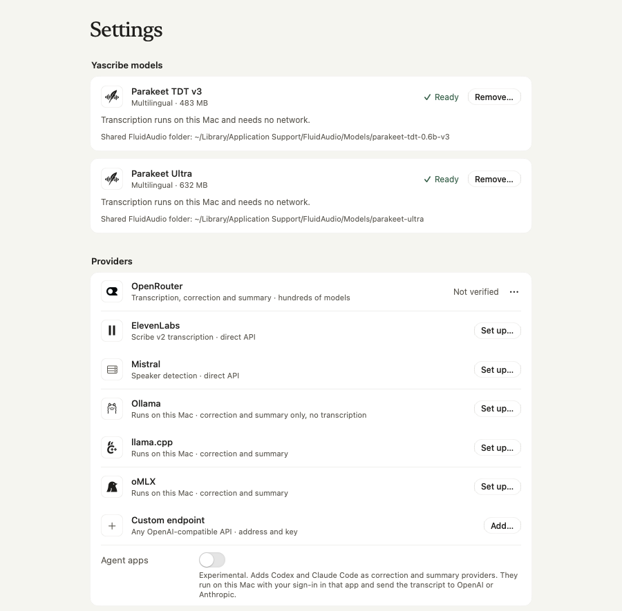

<p align="center">
  <picture>
    <source media="(prefers-color-scheme: dark)" srcset="docs/readme/logo/logo-pionowe-ciemne.svg">
    
  </picture>
</p>

# Yascribe: skryba, który rozumie po polsku

Natywna aplikacja macOS do notatek ze spotkań. Nagrywa rozmowę na Macu, zapisuje ją po polsku, rozpoznaje, kto mówi, i układa z niej notatkę. Możesz też zadawać pytania o jedno spotkanie albo całe archiwum i dyktować tekst do dowolnej aplikacji. **Do rozmowy nie dołącza żaden bot.**

*English: a native macOS meeting-notes app that records system audio and microphone as two separate tracks, transcribes locally or via API, tells speakers apart, writes notes with a model you choose, answers questions about your meetings and does system-wide dictation. The app UI is currently English; Polish UI is planned.*

Język wybierasz sam · lokalnie albo przez API · dwa tory dźwięku · wolne oprogramowanie (GPL-3.0). Projekt jednoosobowy, w budowie (wersje alfa 0.1.x). Interfejs aplikacji jest na razie po angielsku (polska wersja jest w planie), dokumenty w repo po polsku.

<table>
  <tr>
    <td width="50%">
      <picture>
        <source media="(prefers-color-scheme: dark)" srcset="docs/readme/img/meetings-next-dark.png">
        
      </picture>
      <b>Najbliższe spotkanie pod ręką.</b> Karta z kalendarza Apple z jednym przyciskiem Record, foldery spotkań, a na dole pole „Ask about All meetings”.
    </td>
    <td width="50%">
      <picture>
        <source media="(prefers-color-scheme: dark)" srcset="docs/readme/img/meeting-summary-dark.png">
        
      </picture>
      <b>Spotkanie otwiera się na notatce.</b> Podsumowanie z zadaniami, które mają właściciela i powód. Obok Copy i Improve… do ponownego przebiegu innym modelem.
    </td>
  </tr>
  <tr>
    <td width="50%">
      <picture>
        <source media="(prefers-color-scheme: dark)" srcset="docs/readme/img/speakers-transcript-dark.png">
        
      </picture>
      <b>Kto mówi.</b> Rozmówcy dostają numery i kolory. Kliknięcie mówcy otwiera „Who is this?” z uczestnikami z kalendarza i osobami z poprzednich spotkań.
    </td>
    <td width="50%">
      <picture>
        <source media="(prefers-color-scheme: dark)" srcset="docs/readme/img/speakers-summary-dark.png">
        
      </picture>
      <b>Imiona także w notatce.</b> Notatka pokazuje bieżące imiona mówców. Zmiana imienia od razu poprawia notatkę, kopię i archiwum, bez ponownego generowania.
    </td>
  </tr>
</table>

*Dane na zrzutach są przykładowe.*

## Dlaczego polski nie jest tu dodatkiem

Po angielsku gotowe narzędzia działają dobrze. Polski wymaga zwykle trybu wielojęzycznego, w którym model sam zgaduje język i potrafi się pomylić, na przykład zapisać polską rozmowę cyrylicą. Dlatego w Yascribe **język podajesz modelowi wprost**, a automatyczne wykrywanie jest tylko awaryjne.

- **Język ustawiasz sam.** Preset łączy język z modelami transkrypcji, korekty i notatki, więc nie mogą się rozjechać. Przy starcie nagrania widzisz, że działa „Polish · PL".
- **Polskie przerywniki znikają.** Yyy, mhm i podobne wypadają z transkryptu po korekcie. Surowy zapis zostaje nietknięty.
- **Modele, które znają polski.** Parakeet TDT v3 (483 MB) i Parakeet Ultra (632 MB) działają w całości na Macu, bez sieci.
- **Nazwy własne i odmiana.** Słownik z własnymi terminami i aliasami poprawia zapis, także w odmienionych formach. Terminy i uczestnicy z kalendarza trafiają też do poleceń korekty i notatki.
- **Liczby pod kontrolą.** Korekta nie może zmienić sensu wypowiedzi, a notatka ostrzega, gdy pojawi się w niej liczba, której nie było w transkrypcie.

## Jak to działa

1. **Nagrywasz.** Dźwięk systemowy i mikrofon trafiają do dwóch osobnych plików, nigdy do jednego miksu, bo z miksu nie da się już odzyskać czystego głosu. Każdy tor możesz wyciszyć jednym kliknięciem, a wyciszenie w Teams wycisza tor mikrofonu w nagraniu.
2. **Transkrybujesz.** Lokalnie przez Parakeet albo przez API (OpenRouter, ElevenLabs Scribe v2, oMLX z Whisperem lub Qwen3-ASR, dowolny endpoint zgodny z OpenAI). Echo głośników jest usuwane z toru mikrofonu przed transkrypcją, więc głosy rozmówców nie lądują w „Me”. Przerwaną transkrypcję aplikacja wznawia tam, gdzie stanęła.
3. **Rozpoznajesz mówców.** Scribe v2 sam rozdziela rozmówców. Na Macu działa lokalny model wykrywania mówców, a w chmurze także Mistral. Mówcom nadajesz imiona jednym kliknięciem.
4. **Poprawiasz.** Model usuwa przerywniki, a słownik poprawia nazwy własne. Długie spotkania są dzielone na części, żeby mieściły się w kontekście modelu. Przebieg możesz powtórzyć innym modelem (Improve…).
5. **Dostajesz notatkę.** Szablon z własnymi sekcjami, kontekst spotkania i model wybrany osobno dla każdego spotkania. Polecenia korekty i notatki możesz zmienić w Settings.
6. **Pytasz.** „Ask” odpowiada na pytania o jedno spotkanie, folder albo całe archiwum, z odnośnikami do źródeł. Rozmowy zostają w „Past chats”.

Gdy rozmowa w Teams się kończy, pigułka pyta „Meeting ended?" i bez odpowiedzi kończy nagranie po 5 sekundach (Continue je przerywa).

**Dyktowanie.** Globalny skrót (domyślnie Fn, przytrzymaj albo naciśnij) dyktuje tekst do dowolnej aplikacji. Ten sam model transkrypcji, słownik i filtr przerywników, opcjonalna korekta, historia tylko tekstowa.

<table>
  <tr>
    <td width="50%">
      <picture>
        <source media="(prefers-color-scheme: dark)" srcset="docs/readme/img/pill-expanded-dark.png">
        
      </picture>
      <b>Pigułka podczas nagrania.</b> System i mikrofon na osobnych poziomach, z nazwą urządzenia i wyciszeniem na torze. Mikrofon zmienisz w trakcie nagrania.
    </td>
    <td width="50%">
      <picture>
        <source media="(prefers-color-scheme: dark)" srcset="docs/readme/img/pill-offer-call-dark.png">
        
      </picture>
      <b>Rozmowa w Teams? Zapyta.</b> Aplikacja wykrywa rozmowę i proponuje start z wybranym presetem.
    </td>
  </tr>
  <tr>
    <td width="50%">
      <picture>
        <source media="(prefers-color-scheme: dark)" srcset="docs/readme/img/templates-builtin-dark.png">
        
      </picture>
      <b>Szablony ze swoimi sekcjami.</b> Standard, 1:1, cotygodniówka, rozmowa z klientem albo własny. Każda sekcja ma opis tego, co model ma w niej zapisać.
    </td>
    <td width="50%">
      <picture>
        <source media="(prefers-color-scheme: dark)" srcset="docs/readme/img/settings-on-this-mac-dark.png">
        
      </picture>
      <b>Własny model albo chmura.</b> Parakeet na Macu, OpenRouter, ElevenLabs, Mistral, Ollama, llama.cpp, oMLX, dowolny endpoint zgodny z OpenAI, a eksperymentalnie Codex i Claude Code z Twoim logowaniem.
    </td>
  </tr>
</table>

## Twoje dane

- **Bez bota.** Nagrywa Mac, a nie uczestnik spotkania. Nikt na rozmowie nie widzi dodatkowej osoby.
- **Wszystko lokalnie.** Nagrania, transkrypty i notatki leżą w `~/Library/Application Support/Yascribe`. Transkrypcja Parakeetem, wykrywanie mówców na Macu i notatka przez Ollamę, llama.cpp albo oMLX działają bez sieci. Do chmury trafia tylko to, co sam wybierzesz, a aplikacja mówi przy wyborze, dokąd idzie transkrypt.
- **Audio z terminem.** Audio możesz usuwać automatycznie po wybranym czasie, na przykład po 30 dniach. Transkrypty i notatki zostają, a audio czeka na zakończoną transkrypcję.
- **Klucze API** trzymane są w pęku kluczy macOS i wpisujesz je sam w aplikacji. Codex i Claude Code używają własnego logowania, Yascribe nie trzyma do nich kluczy.

## Instalacja

1. Pobierz `Yascribe-<wersja>.zip` z [Releases](https://github.com/sharezz1/yascribe/releases/latest), rozpakuj i przeciągnij `Yascribe.app` do `/Applications`.
2. Aplikacja jest podpisana certyfikatem Apple Development, ale **nie jest notaryzowana**, więc macOS zapyta o zgodę przy pierwszym uruchomieniu (Ustawienia systemowe → Prywatność i ochrona → „Otwórz mimo to"). Notaryzacja jest w planie.
3. Przy pierwszym nagraniu zatwierdź dostęp do mikrofonu, dźwięku systemowego i (opcjonalnie) kalendarza. Synchronizacja wyciszenia z Teams i dyktowanie wymagają jeszcze zgody Accessibility, a skrót dyktowania także Input Monitoring.
4. Aktualizacje: Yascribe → „Check for Updates…" albo z menu na pasku. Instalacja zawsze na Twoje kliknięcie i nigdy nie przerywa trwającego nagrania.

Wymagania: macOS 27.

## Co dalej

**Mamy:** nagrywanie dwóch torów z wyciszaniem, wykrywaniem końca spotkania i zmianą mikrofonu w trakcie · usuwanie echa głośników z toru mikrofonu · transkrypcja lokalna (Parakeet v3, Parakeet Ultra) i przez API · rozpoznawanie mówców z imionami w transkrypcie i notatce · korekta z filtrem przerywników i własnymi poleceniami · słownik z odmianą, importem i eksportem · notatki z szablonów, model per spotkanie · Ask nad spotkaniem, folderem i archiwum · dyktowanie do dowolnej aplikacji · modele lokalne (Ollama, llama.cpp, oMLX, własny endpoint) i agent CLI (Codex, Claude Code) · nagrywanie na słuchawkach Bluetooth · kalendarz Apple i oferta startu przy rozmowie w Teams · foldery, krótki opis spotkania (Overview), archiwum z wyszukiwarką i retencją audio · jasny i ciemny motyw · aktualizacje jednym kliknięciem · narzędzie `yascribe-cli` do transkrypcji, korekty, notatek i mówców z terminala.

**W kolejce:**
- polski interfejs (aplikacja rozumie po polsku, a sama jest po angielsku),
- klik na słowo w transkrypcie dopisuje alias do słownika; podpowiadanie słów lokalnemu modelowi (word boosting) po pomiarze,
- transkrypt na żywo i wznawianie nagrania do tej samej notatki,
- kolejne lokalne modele transkrypcji,
- „Record now” w menu na pasku.

**Pomysły bez terminu:** notaryzacja i Developer ID · Google Calendar, Outlook, Slack · MCP dla Claude i eksport do markdown.

## Budowanie

Wystarczą Command Line Tools (Swift 6.4), bez Xcode.

```
swift package --disable-keychain resolve
scripts/run.sh          # buduje i uruchamia z danymi w .devdata/
scripts/test.sh         # jedyny sposób uruchamiania testów
scripts/bundle.sh       # składa .build/Yascribe.app
```

## Nazwa i znak

Motto „What's it like to be a scribe?" nawiązuje do monologu skryby z „Asterix i Obelix: Misja Kleopatra". Pióro to zapis, a fale po bokach to dwa kanały nagrania: system i mikrofon.

## Licencja

Yascribe jest wolnym oprogramowaniem na licencji **GNU GPL v3** (plik [LICENSE](LICENSE)). Licencje zależności i atrybucje: [THIRD_PARTY_NOTICES.md](THIRD_PARTY_NOTICES.md).

Copyright (C) 2026 Michał Przytulski
