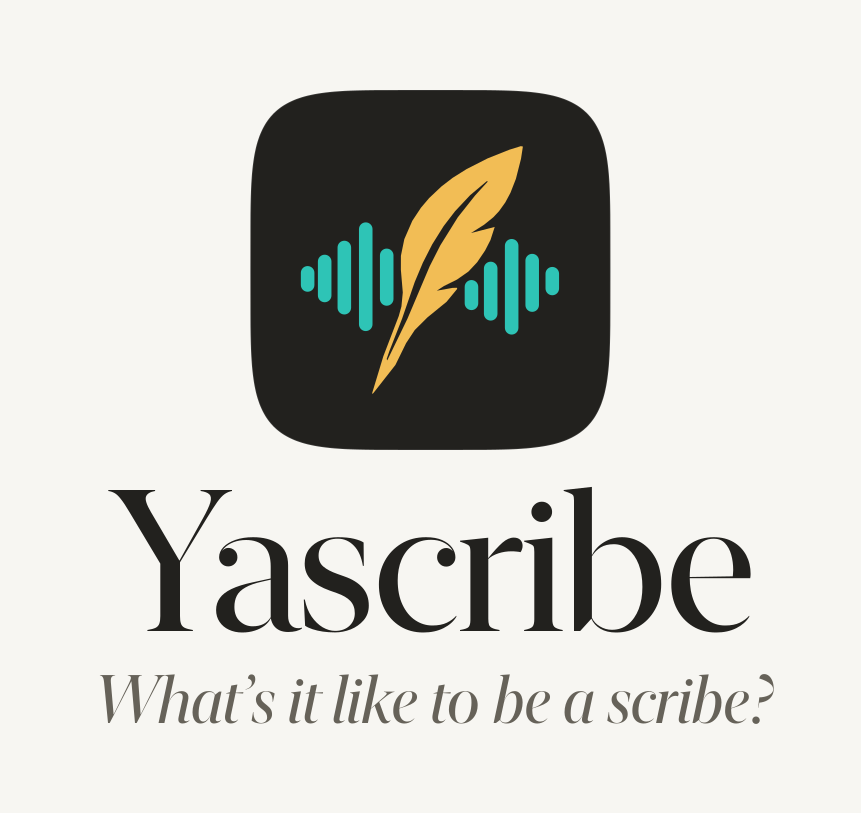
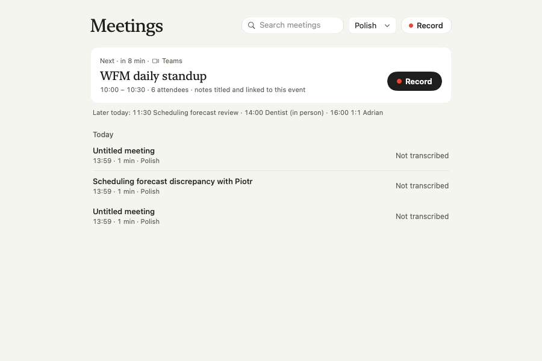
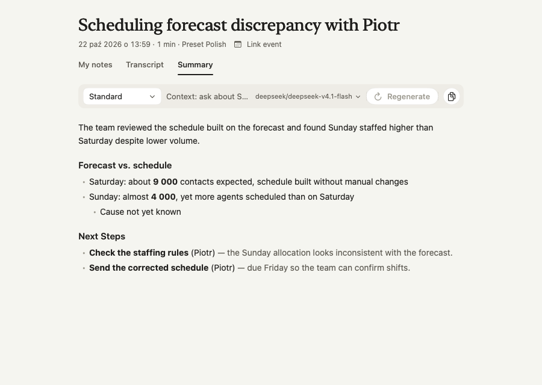
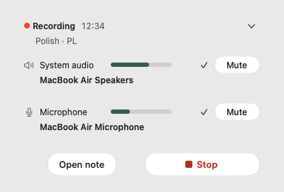
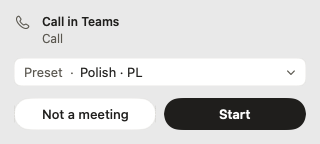
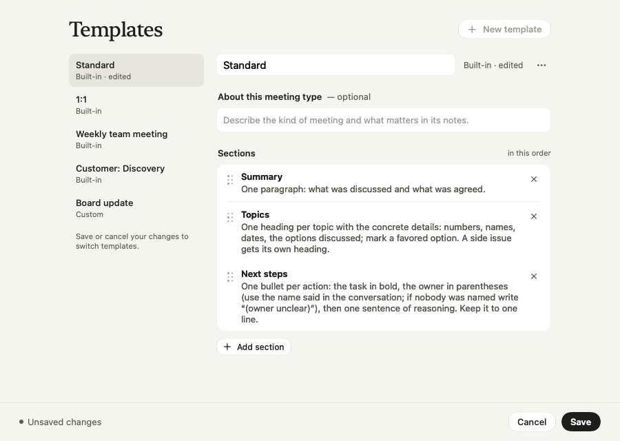
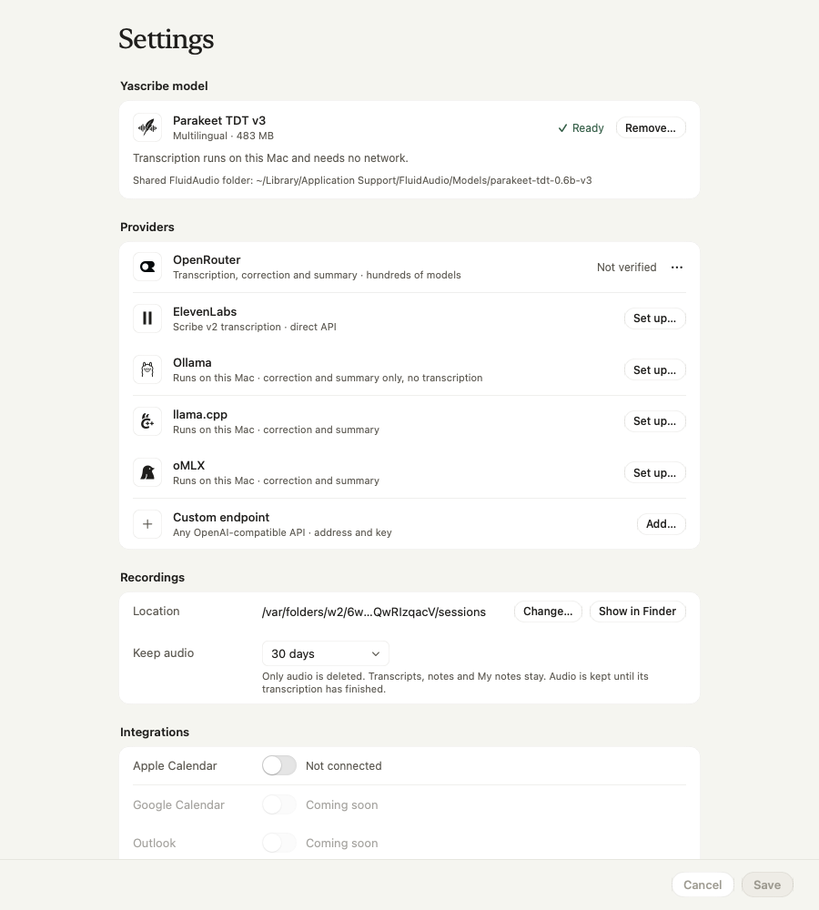

<p align="center">
  <picture>
    <source media="(prefers-color-scheme: dark)" srcset="docs/readme/logo/logo-pionowe-ciemne.svg">
    
  </picture>
</p>

# Yascribe: skryba, który rozumie po polsku

Natywna aplikacja macOS do notatek ze spotkań. Nagrywa rozmowę na Macu, zapisuje ją po polsku i układa z niej notatkę. **Do rozmowy nie dołącza żaden bot.**

*English: a native macOS meeting-notes app that records system audio and microphone as two separate tracks, transcribes locally or via API, and writes notes with a model you choose. The app UI is currently English; Polish UI is planned.*

Język wybierasz sam · lokalnie albo przez API · dwa tory dźwięku · wolne oprogramowanie (GPL-3.0). Projekt jednoosobowy, w budowie. Interfejs aplikacji jest na razie po angielsku (polska wersja jest w planie), dokumenty w repo po polsku.

<table>
  <tr>
    <td width="50%">
      <picture>
        <source media="(prefers-color-scheme: dark)" srcset="docs/readme/img/meetings-next-dark.png">
        
      </picture>
      <b>Najbliższe spotkanie pod ręką.</b> Karta z kalendarza Apple: godzina, liczba uczestników i jeden przycisk Record. Notatka dostaje tytuł z wydarzenia.
    </td>
    <td width="50%">
      <picture>
        <source media="(prefers-color-scheme: dark)" srcset="docs/readme/img/meeting-summary-dark.png">
        
      </picture>
      <b>Podsumowanie z zadaniami.</b> Szablon, kontekst i model w jednym pasku. Zadania mają właściciela, powód i termin.
    </td>
  </tr>
</table>

*Dane na zrzutach są przykładowe.*

## Dlaczego polski nie jest tu dodatkiem

Po angielsku gotowe narzędzia działają dobrze. Polski wymaga zwykle trybu wielojęzycznego, w którym model sam zgaduje język i potrafi się pomylić, na przykład zapisać polską rozmowę cyrylicą. Dlatego w Yascribe **język podajesz modelowi wprost**, a automatyczne wykrywanie jest tylko awaryjne.

- **Język ustawiasz sam.** Preset łączy język z modelami transkrypcji, korekty i notatki, więc nie mogą się rozjechać. Przy starcie nagrania widzisz, że działa „Polish · PL".
- **Polskie przerywniki znikają.** Yyy, mhm i podobne wypadają z transkryptu po korekcie. Surowy zapis zostaje nietknięty.
- **Model, który zna polski.** Parakeet TDT v3 działa w całości na Macu: 483 MB, bez sieci, ok. 170 razy szybciej, niż trwa nagranie.
- **Nazwy własne.** Słownik z własnymi terminami i aliasami poprawia zapis przy odczycie transkryptu, a terminy i uczestnicy z kalendarza trafiają też do poleceń korekty i notatki.

## Jak to działa

1. **Nagrywasz.** Dźwięk systemowy i mikrofon trafiają do dwóch osobnych plików, nigdy do jednego miksu, bo z miksu nie da się już odzyskać czystego głosu. Każdy tor możesz wyciszyć jednym kliknięciem, a wyciszenie w Teams wycisza tor mikrofonu w nagraniu.
2. **Transkrybujesz.** Lokalnie przez Parakeet albo przez API (OpenRouter, ElevenLabs Scribe v2). Przerwaną transkrypcję aplikacja wznawia tam, gdzie stanęła.
3. **Poprawiasz.** Model usuwa przerywniki, a słownik poprawia nazwy własne. Długie spotkania są dzielone na części, żeby mieściły się w kontekście modelu. Przebieg możesz powtórzyć innym modelem („Transcribe again…").
4. **Dostajesz notatkę.** Szablon z własnymi sekcjami, kontekst spotkania i model wybrany osobno dla każdego spotkania.

Gdy rozmowa w Teams się kończy, pigułka pyta „Meeting ended?" i bez odpowiedzi kończy nagranie po 5 sekundach (Continue je przerywa).

<table>
  <tr>
    <td width="50%">
      <picture>
        <source media="(prefers-color-scheme: dark)" srcset="docs/readme/img/pill-expanded-dark.png">
        
      </picture>
      <b>Pigułka podczas nagrania.</b> System i mikrofon na osobnych poziomach, z nazwą urządzenia i wyciszeniem na torze.
    </td>
    <td width="50%">
      <picture>
        <source media="(prefers-color-scheme: dark)" srcset="docs/readme/img/pill-offer-call-dark.png">
        
      </picture>
      <b>Rozmowa w Teams? Zapyta.</b> Aplikacja wykrywa rozmowę i proponuje start z wybranym presetem.
    </td>
  </tr>
  <tr>
    <td width="50%">
      <picture>
        <source media="(prefers-color-scheme: dark)" srcset="docs/readme/img/templates-builtin-dark.png">
        
      </picture>
      <b>Szablony ze swoimi sekcjami.</b> Standard, 1:1, cotygodniówka, rozmowa z klientem albo własny. Każda sekcja ma opis tego, co model ma w niej zapisać.
    </td>
    <td width="50%">
      <picture>
        <source media="(prefers-color-scheme: dark)" srcset="docs/readme/img/settings-on-this-mac-dark.png">
        
      </picture>
      <b>Własny model albo chmura.</b> Karta modelu Yascribe, OpenRouter, ElevenLabs, Ollama, llama.cpp, oMLX i dowolny endpoint zgodny z OpenAI.
    </td>
  </tr>
</table>

## Twoje dane

- **Bez bota.** Nagrywa Mac, a nie uczestnik spotkania. Nikt na rozmowie nie widzi dodatkowej osoby.
- **Wszystko lokalnie.** Nagrania, transkrypty i notatki leżą w `~/Library/Application Support/Yascribe`. Transkrypcja Parakeetem i notatka przez Ollamę, llama.cpp albo oMLX działają bez sieci. Do chmury trafia tylko to, co sam wybierzesz.
- **Audio z terminem.** Audio możesz usuwać automatycznie po wybranym czasie, na przykład po 30 dniach. Transkrypty i notatki zostają, a audio czeka na zakończoną transkrypcję.
- **Klucze API** trzymane są w pęku kluczy macOS i wpisujesz je sam w aplikacji.

## Instalacja

1. Pobierz `Yascribe-<wersja>.zip` z [Releases](https://github.com/sharezz1/yascribe/releases/latest), rozpakuj i przeciągnij `Yascribe.app` do `/Applications`.
2. Aplikacja jest podpisana samopodpisanym certyfikatem i **nie jest notaryzowana**, więc macOS zapyta o zgodę przy pierwszym uruchomieniu (Ustawienia systemowe → Prywatność i ochrona → „Otwórz mimo to"). Notaryzacja jest w planie.
3. Przy pierwszym nagraniu zatwierdź dostęp do mikrofonu, dźwięku systemowego i (opcjonalnie) kalendarza. Synchronizacja wyciszenia z Teams wymaga jeszcze zgody Accessibility.
4. Aktualizacje: Yascribe → „Check for Updates…". Instalacja zawsze na Twoje kliknięcie i nigdy nie przerywa trwającego nagrania.

Wymagania: macOS 27.

## Co dalej

**Mamy:** nagrywanie dwóch torów z wyciszaniem i wykrywaniem końca spotkania · transkrypcja lokalna (Parakeet v3) i przez API · korekta z filtrem przerywników · słownik z importem i eksportem · notatki z szablonów, model per spotkanie · modele lokalne (Ollama, llama.cpp, oMLX, własny endpoint) · nagrywanie na słuchawkach Bluetooth · kalendarz Apple i oferta startu przy rozmowie w Teams · archiwum z wyszukiwarką, retencją audio i jasnym/ciemnym motywem · aktualizacje jednym kliknięciem.

**W kolejce:**
- polski interfejs (aplikacja rozumie po polsku, a sama jest po angielsku),
- klik na słowo w transkrypcie dopisuje alias do słownika; podpowiadanie słów lokalnemu modelowi (word boosting) po pomiarze,
- **echo głośników w mikrofonie** (wysoki priorytet): usuwanie echa, żeby głosy rozmówców nie lądowały w torze „Me",
- transkrypt na żywo i wznawianie nagrania do tej samej notatki,
- wybór mikrofonu i wyjścia przed startem (mikrofon da się już zmienić w pigułce w trakcie nagrania).

**Pomysły bez terminu:** czat nad spotkaniem i archiwum · rozpoznawanie rozmówców i zakładka z zadaniami · punkty notatki z odnośnikiem do transkryptu · MCP dla Claude i eksport do markdown · dyktowanie na żywo · wbudowany model tekstowy · Google Calendar, Outlook, Slack · notaryzacja.

Szczegółowa mapa faz i statusów: [docs/superpowers/ROADMAP.md](docs/superpowers/ROADMAP.md).

## Budowanie

Wystarczą Command Line Tools (Swift 6.4), bez Xcode.

```
swift package --disable-keychain resolve
scripts/run.sh          # buduje i uruchamia z danymi w .devdata/
scripts/test.sh         # jedyny sposób uruchamiania testów
scripts/bundle.sh       # składa .build/Yascribe.app
```

Wymagania: [docs/wymagania.md](docs/wymagania.md); plany i stan faz: [docs/superpowers/ROADMAP.md](docs/superpowers/ROADMAP.md).

## Nazwa i znak

Motto „What's it like to be a scribe?" nawiązuje do monologu skryby z „Asterix i Obelix: Misja Kleopatra". Pióro to zapis, a fale po bokach to dwa kanały nagrania: system i mikrofon.

## Licencja

Yascribe jest wolnym oprogramowaniem na licencji **GNU GPL v3** (plik [LICENSE](LICENSE)). Licencje zależności i atrybucje: [THIRD_PARTY_NOTICES.md](THIRD_PARTY_NOTICES.md).

Copyright (C) 2026 Michał Przytulski
