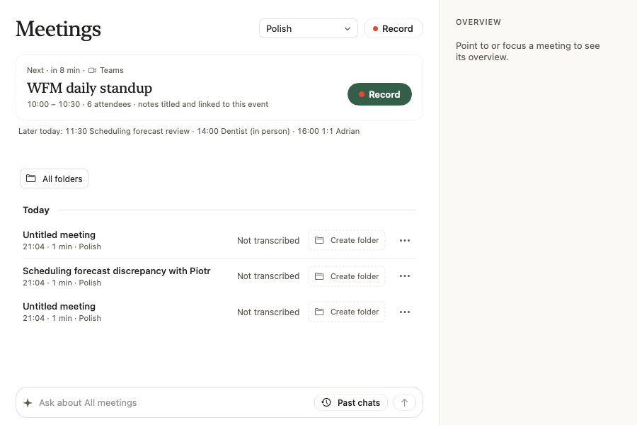
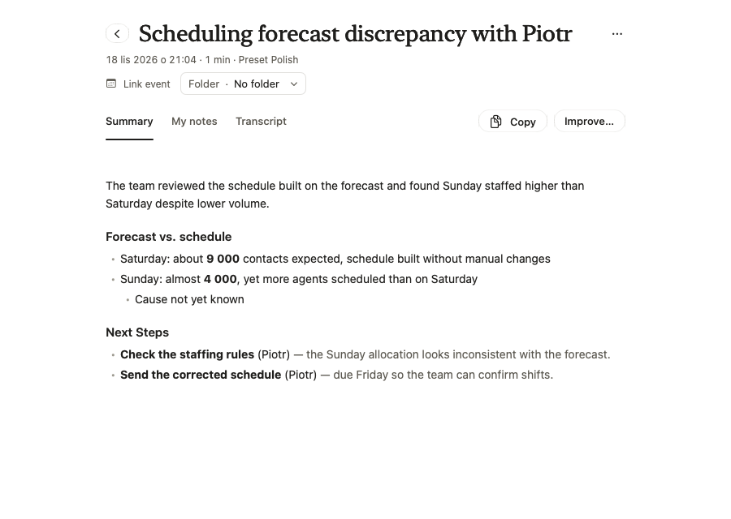
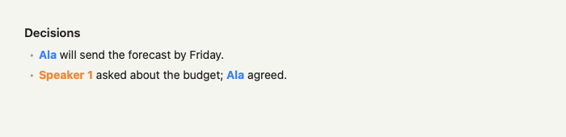
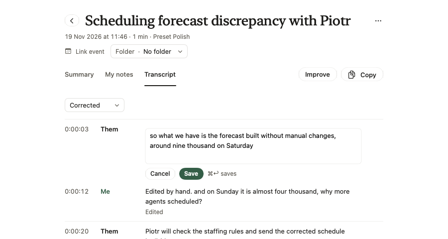
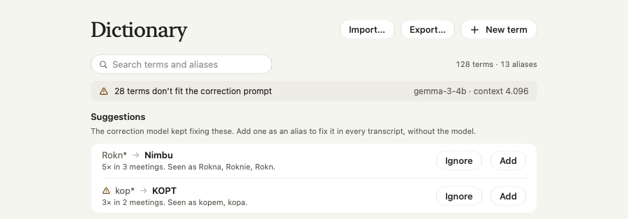
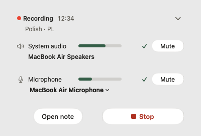

<p align="center">
  <picture>
    <source media="(prefers-color-scheme: dark)" srcset="docs/readme/logo/logo-pionowe-ciemne.svg">
    
  </picture>
</p>

# Yascribe: a scribe that understands your language

A native macOS app for meeting notes. It records the call on your Mac, transcribes it in the language you choose, tells speakers apart and writes the notes. You can ask questions about one meeting or your whole archive, and dictate text into any app. **No bot joins the call.**

You choose the language and whether your data is processed locally or through an API. The app records audio on two separate tracks and is free software (GPL-3.0). It is a one-person project in active development (alpha releases 0.1.x). The app interface is available in English and Polish; the developer documentation in the repository is in Polish.

<table>
  <tr>
    <td width="50%">
      <picture>
        <source media="(prefers-color-scheme: dark)" srcset="docs/readme/img/meetings-next-dark.png">
        
      </picture>
      <b>Your next meeting.</b> Click “Record” on the card for the next Apple Calendar meeting. The list shows meeting folders, with an “Ask about All meetings” field at the bottom.
    </td>
    <td width="50%">
      <picture>
        <source media="(prefers-color-scheme: dark)" srcset="docs/readme/img/meeting-summary-dark.png">
        
      </picture>
      <b>Open a meeting and see the notes right away.</b> The summary shows who owns each task and where it came from. “Copy” copies the notes, and “Improve…” regenerates them with a different model.
    </td>
  </tr>
  <tr>
    <td width="50%">
      <picture>
        <source media="(prefers-color-scheme: dark)" srcset="docs/readme/img/speakers-transcript-dark.png">
        
      </picture>
      <b>Who is speaking?</b> Each speaker has a number and a color. Click the label to open “Who is this?” with calendar attendees and people from earlier meetings.
    </td>
    <td width="50%">
      <picture>
        <source media="(prefers-color-scheme: dark)" srcset="docs/readme/img/speakers-summary-dark.png">
        
      </picture>
      <b>Names in the notes, too.</b> The notes show the names you assigned to the speakers. Rename someone and the change appears at once in the notes, the copy and the archive, without regenerating anything.
    </td>
  </tr>
  <tr>
    <td width="50%">
      <picture>
        <source media="(prefers-color-scheme: dark)" srcset="docs/readme/img/transcript-edit-dark.png">
        
      </picture>
      <b>Listen and fix by hand.</b> Hover over a segment and click ▶ to hear exactly that part of the recording. Click the pencil to edit the text. Your fix is marked “Edited”, and the raw transcript stays untouched.
    </td>
    <td width="50%">
      <picture>
        <source media="(prefers-color-scheme: dark)" srcset="docs/readme/img/dictionary-suggestions-dark.png">
        
      </picture>
      <b>Dictionary suggestions.</b> When the correction model keeps changing the same word to a dictionary term, the app suggests adding it as an alias. Click “Add” or “Ignore”. Ignored suggestions do not come back.
    </td>
  </tr>
</table>

*The screenshots show sample data.*

## Your language, not just English

Most tools work well in English. Other languages usually need a multilingual mode in which the model guesses the language. Sometimes it guesses wrong, and a Polish call ends up written in Cyrillic. In Yascribe, **you tell the model which language to use**. Automatic detection is only a fallback for mixed-language meetings.

- **One language setting.** A preset sets the language and the models for transcription, correction and notes, so every step uses the same language. You can pick from 15 languages, including English, Polish, German, French, Spanish and Italian. The notes can be written in a different language than the meeting. When you start recording, you see the preset language, for example “Polish · PL”.
- **Filler sounds removed.** Correction removes sounds like “um”, “uh” or the Polish “yyy” and “mhm”. You can edit the list. The raw transcript stays untouched.
- **Local multilingual models.** Parakeet TDT v3 (483 MB) and Parakeet Ultra (632 MB) run entirely on your Mac, with no network access.
- **Names and inflected forms.** Add your own terms and aliases to the dictionary. It helps spell names correctly, including inflected forms. The app passes dictionary terms and calendar attendees to the correction and notes prompts. When the correction model fixes the same mistake several times, the app suggests a new alias.
- **Number check.** Correction must keep the meaning. The notes show a warning if they contain a number that was not in the transcript.

## How it works

1. **Record.** The app saves system audio and microphone audio to separate files, because a mixed recording cannot be split back into clean voices. You can mute each track with one click. When you mute your microphone in Teams, the app mutes its track in the recording too.
2. **Transcribe.** Use the local Parakeet model or an API: OpenRouter, ElevenLabs Scribe v2, oMLX with Whisper or Qwen3-ASR, or any OpenAI-compatible endpoint. Before transcription the app removes speaker echo from the microphone track, so other people's voices are not attributed to “Me”. If transcription stops, the app resumes where it left off.
3. **Tell speakers apart.** Scribe v2 separates speakers on its own. On your Mac a local model does it, and in the cloud you can also use Mistral. Assign names to speakers with one click.
4. **Correct.** A model removes filler sounds, and the dictionary fixes names. The app splits long meetings into parts that fit the model's context window. “Improve…” repeats the correction with a different model. In the transcript you can listen to any segment and fix it by hand. Your fixes are used in the copy, in search and when you regenerate the notes.
5. **Get the notes.** The app writes them from a template with your own sections and from the meeting context. You can choose the model for each meeting. In “Settings” you can edit the correction and notes prompts.
6. **Ask.** In the “Ask” field you can ask about one meeting, a folder or the whole archive. Answers link to their sources. Earlier conversations are under “Past chats”.

When a Teams call ends, the recording panel asks “Meeting ended?”. With no answer within 5 seconds, the app stops recording. “Continue” cancels the countdown.

**Dictation.** To dictate into any app, hold or press the global shortcut key (Fn by default). Dictation uses the same transcription model, dictionary and filler filter. Correction is optional, and the history keeps only text.

**Interface language.** The globe button next to the light/dark switch lets you choose “English”, “Polski” or “Auto” (follows macOS). The change takes effect after the app restarts.

<table>
  <tr>
    <td width="50%">
      <picture>
        <source media="(prefers-color-scheme: dark)" srcset="docs/readme/img/pill-expanded-dark.png">
        
      </picture>
      <b>Recording panel.</b> The panel shows the device name and separate levels for system audio and the microphone. You can mute each track and switch the microphone during the recording.
    </td>
    <td width="50%">
      <picture>
        <source media="(prefers-color-scheme: dark)" srcset="docs/readme/img/pill-offer-call-dark.png">
        
      </picture>
      <b>Recording Teams calls.</b> When the app detects a call, it offers to start recording with the preset you choose.
    </td>
  </tr>
  <tr>
    <td width="50%">
      <picture>
        <source media="(prefers-color-scheme: dark)" srcset="docs/readme/img/templates-builtin-dark.png">
        
      </picture>
      <b>Note templates.</b> Choose Standard, 1:1, a weekly team meeting or a customer call, or create your own. The description of each section tells the model what to write there.
    </td>
    <td width="50%">
      <picture>
        <source media="(prefers-color-scheme: dark)" srcset="docs/readme/img/settings-on-this-mac-dark.png">
        
      </picture>
      <b>Local and cloud models.</b> Choose from Parakeet on your Mac, OpenRouter, ElevenLabs, Mistral, Ollama, llama.cpp, oMLX and any OpenAI-compatible endpoint. As an experiment, you can also use Codex and Claude Code with your own account.
    </td>
  </tr>
</table>

## Your data

- **No bot.** You record the call on your own Mac. Other participants see no extra attendee.
- **Everything stays local.** Recordings, transcripts and notes are stored in `~/Library/Application Support/Yascribe`. You can transcribe with Parakeet, tell speakers apart on your Mac and write notes with Ollama, llama.cpp or oMLX without any network access. The app sends to the cloud only what you choose, and when you pick a provider it shows where the transcript will go.
- **Recording retention.** You can have recordings deleted automatically after a set time, for example 30 days. Transcripts and notes are kept, and recordings are deleted only after transcription has finished.
- **API keys** are entered in the app and stored in the macOS keychain. Codex and Claude Code use their own sign-in. Yascribe does not store their keys.

## AI agents (MCP)

Yascribe includes a stdio MCP server, so Claude Code, Codex, OpenCode, Hermes and pi can read your meetings: the list with search, the transcript and the notes, or a whole meeting as Markdown. The server is read-only, and nothing leaves it without your consent: turn access on in **Settings → Agent access (MCP)**. Setup for each client (in Polish): [docs/readme/mcp.md](docs/readme/mcp.md).

## Installation

1. Download `Yascribe-<version>.zip` from [Releases](https://github.com/sharezz1/yascribe/releases/latest), unzip it and drag `Yascribe.app` to `/Applications`.
2. The app is signed with an Apple Development certificate. **It is not notarized yet**, so on first launch macOS asks for permission (System Settings → Privacy & Security → “Open Anyway”). Notarization is planned.
3. On the first recording, allow access to the microphone, system audio and, optionally, the calendar. Mute sync with Teams and dictation also need the “Accessibility” permission, and the dictation shortcut also needs “Input Monitoring”.
4. Check for updates in Yascribe → “Check for Updates…” or in the menu bar menu. The app installs an update only when you click it and never interrupts a recording.
5. After each launch the app tests the connection to your configured providers. It skips custom endpoints, so it does not wake up a paid server.

Requires macOS 27.

## Roadmap

**Already works.** Two-track recording with muting, end-of-meeting detection and switching the microphone mid-recording · speaker echo removal from the microphone track · local (Parakeet v3, Parakeet Ultra) and API transcription · segment playback and manual transcript fixes · speaker detection with names in the transcript and the notes · correction with a filler filter and your own prompts · a dictionary with inflection, import and export, and alias suggestions from correction · notes from templates and a model choice per meeting · questions in “Ask” about a meeting, a folder or the archive · dictation into any app · local models (Ollama, llama.cpp, oMLX, a custom endpoint) and CLI agents (Codex, Claude Code) · recording with Bluetooth headphones · Apple Calendar and a recording offer when a Teams call is detected · folders, a short meeting “Overview”, and an archive with search and recording retention · English and Polish interface · light and dark theme · one-click updates · the `yascribe-cli` tool for transcription, correction, notes and speaker detection in the terminal · an MCP server for AI agents (meeting list, transcript, notes and Markdown export).

**Next up**

- adding a dictionary alias by clicking a word in the transcript, and word boosting for the local model after measurements,
- live transcription and resuming a recording into the same note,
- more local transcription models,
- a record button in the menu bar menu.

**Ideas without a date.** Notarization and Developer ID · Google Calendar, Outlook, Slack.

## Building

Command Line Tools (Swift 6.4) are enough. Xcode is not needed.

```
swift package --disable-keychain resolve
scripts/run.sh          # builds and runs with data in .devdata/
scripts/test.sh         # the only way to run the tests
scripts/bundle.sh       # assembles .build/Yascribe.app
```

## Name and logo

The motto “What's it like to be a scribe?” refers to the scribe's monologue in the film “Asterix & Obelix: Mission Cleopatra”. The quill stands for writing, and the waves on both sides are the two recording tracks: one for system audio and one for the microphone.

## License

Yascribe is free software under the **GNU GPL v3** (see [LICENSE](LICENSE)). Dependency licenses and credits are in [THIRD_PARTY_NOTICES.md](THIRD_PARTY_NOTICES.md).

Copyright (C) 2026 Michał Przytulski
